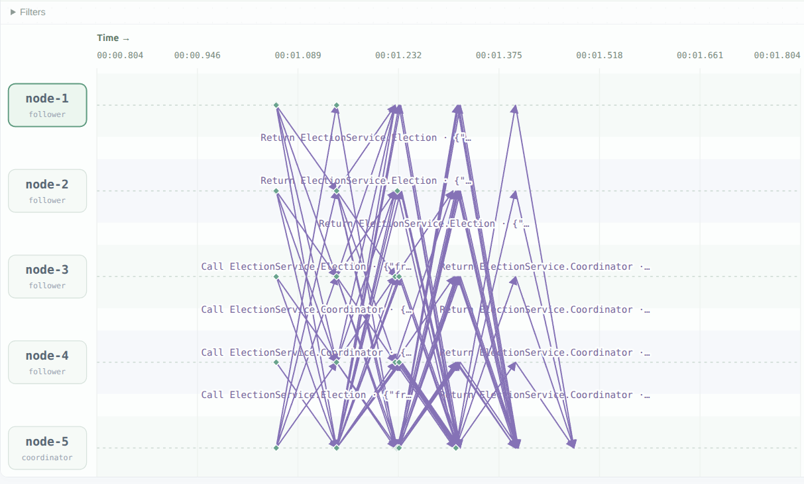

Bully Election
Observation scenario A:

All nodes started at the same time in our simulated environment.

Node-5 tried to look up the nodes with numbers higher than him, but found none, so he automatically became the coordinator immediately, and then he broadcasted the coordinator message. But before the message arrived at other nodes, they all had sent out election messages. The implementation of our initial code let the coordinator respond to all of these election messages with a whole broadcast, which is highly suboptimal, and wastes the coordinator's bandwidth.

This begs a more general question:  
How should a newcomer find out who the leader is, if the selection was done before his joining.

scenarioB

There's a per-second heartbeat, 