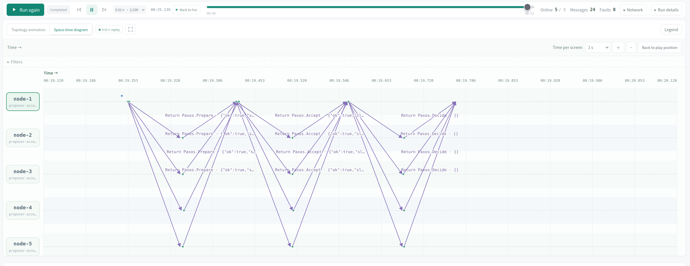
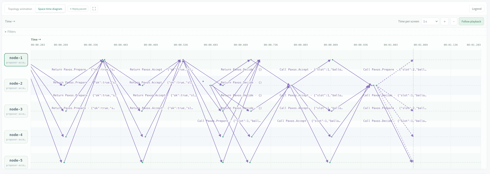
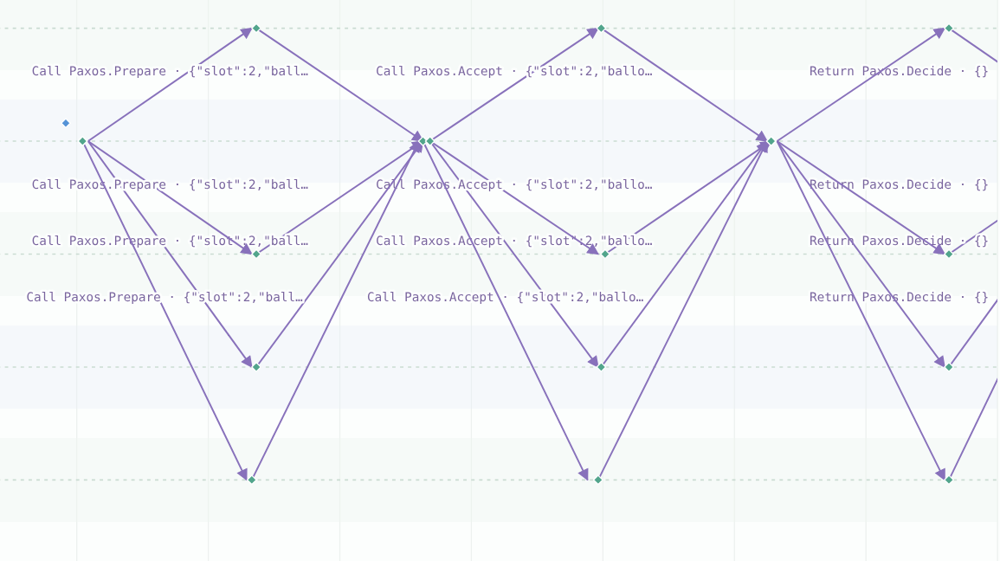
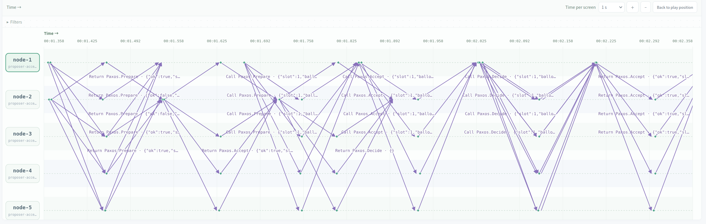
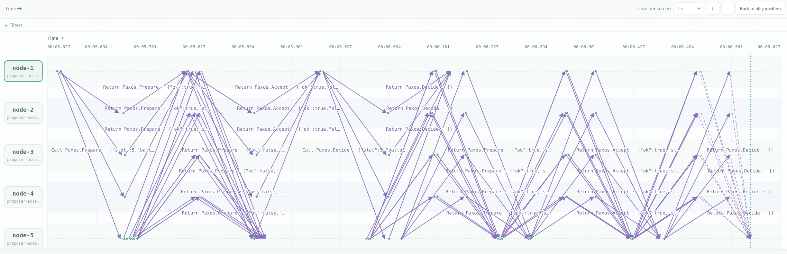
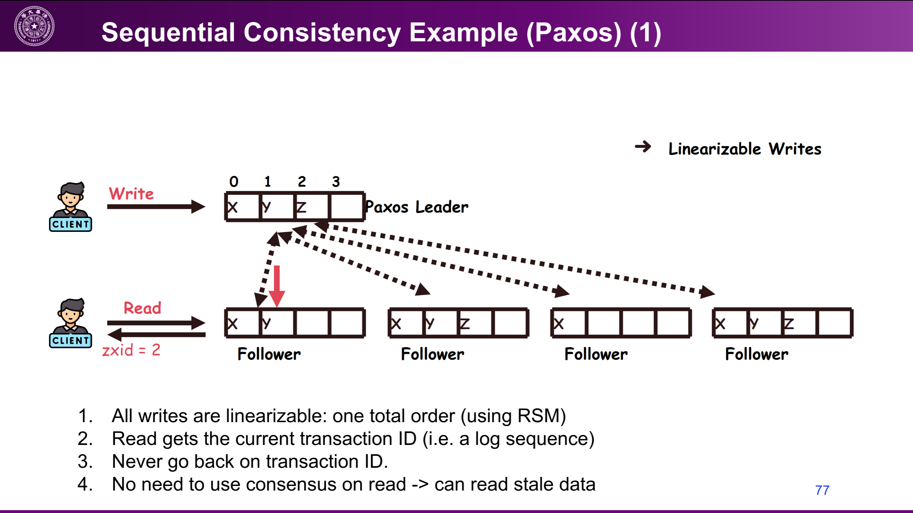

# Paxos Replicated State Machine KV

**Lab 1 · L05 Replication and Consensus · §5.4**

**Contents:** [Scenario A](#scenario-a--sequential-writes-and-reads) · [Scenario B](#scenario-b--two-writes-compete-for-one-slot) · [Scenario C](#scenario-c--crash-and-catch-up) · [Scenario D](#scenario-d--the-minority-cannot-commit) · [Reflections](#reflections) · [Reproduction setup](#appendix--reproduction-setup)

> **Reading the evidence.** Each `#number` refers to the `seq` field [event sequence number] in that section's linked experiment export. The screenshots are retained from my original observations; the supporting automated runs can have different ballot numbers and timing. For example, my original normal-case notes showed the first Get at ballot 18, while the linked run chose it at ballot 34. Event-specific claims below use the linked JSON rather than assuming both recordings are identical.

---

## Scenario A — Sequential writes and reads

### Observation

Put and Get requests submitted through different nodes occupied consecutive slots, and each Get returned the value of the preceding write. The saved run ended with every node having applied four slots and storing `x = "2"`. This matches the expected behavior: Get is ordered through Paxos rather than immediately reading a potentially outdated local copy. Client success does not require every replica [node holding a copy] to have caught up, but it does require ordered local execution at the node handling the request.

### From acceptance to execution



*Figure A1. One slot passes through Prepare, Accept, and the subsequent Decide notifications.*

These three states must be distinguished:

| State | Meaning |
|---|---|
| **Accepted** | One node has voted for an operation at a particular ballot [ordered proposal number]. One vote alone is not enough. |
| **Chosen** | A majority has accepted the same operation for the same slot and ballot. Paxos has fixed that slot's operation. |
| **Decided locally / applied locally** | `decided: true` records that this node has learned the choice. `applied` records how far the node has executed the log without skipping an earlier slot. |

After obtaining an accepting majority, the proposer [node trying to place an operation in the log] calls its own `Decide()` and notifies the other members in the background. A learner [node learning the chosen operation] need not have voted for that operation. See [decision announcement](../protocol.go#L465-L483) and [the Decide handler](../protocol.go#L251-L275).

The `Decided` flag is **not only a hint for selecting a slot**: it also prevents conflicting local decisions and blocks execution across an unknown earlier decision. A new client operation starts at `Applied + 1`, the first position not yet executed locally; a known decision lets `choose()` avoid another competition for that slot. See [slot selection](../protocol.go#L540-L542), [the known-decision check](../protocol.go#L413-L418), and [ordered execution](../protocol.go#L281-L310).



*Figure A2. A later proposer can learn an earlier chosen operation through Prepare replies.*

An incoming Prepare for a locally decided slot is still handled under the normal ballot rule: a sufficiently high ballot receives a positive reply, while a lower ballot is rejected. The reply contains the accepted operation; the proposer must preserve the operation selected by the highest accepted ballot in its successful Prepare majority. Accept gathers votes for that preserved operation, and Decide announces it. In the saved normal run, **event #121** is node-1's positive reply to node-2, reporting `promised: 18`, `accepted: 17`, `decided: true`, and the earlier `Put("x", "1")`.

### Get also occupies a slot



*Figure A3. The read itself appears in the log after the write.*

The following results are from run `4923e01c-8c5f-4925-b636-8859bcd2736a`: [full log](../experiments/normal/run.json) · [checks](../experiments/normal/checks.json).

| Input event | Request | Result event | Slot | Returned value |
|---|---|---|---:|---|
| #17 | node-1: `Put("x", "1")` | #78 | 1 | `"1"` |
| #85 | node-2: `Get("x")` | #261 | 2 | `"1"` |
| #266 | node-3: `Put("x", "2")` | #383 | 3 | `"2"` |
| #404 | node-4: `Get("x")` | #475 | 4 | `"2"` |

For example, event **#261** contains this result:

```json
{
  "id": "node-2-1",
  "slot": 2,
  "value": "1",
  "found": true,
  "error": ""
}
```

**When does Get return?** Not merely when its slot is decided: it returns after the node handling the request has executed all preceding slots, evaluated the read, and saved the resulting state. Every node that learns decisions runs its own `applyLocked()`; a node with a missing earlier decision stops until it can fill that gap. Only the node handling this client request returns the saved result to that client. See [Decide and persistence](../protocol.go#L266-L274) and [the client-success check](../protocol.go#L563-L575).

<details>
<summary><strong>Code detail — where the value is actually read</strong></summary>

The [execution loop](../protocol.go#L281-L310) always starts at the next unapplied slot:

```go
number := s.disk.Applied + 1
slot := s.disk.Slots[number]
if !slot.Decided {
    return
}
```

After confirming that the operation has not already been executed, it performs the write or read:

```go
switch op.Kind {
case "put":
    s.disk.Values[op.Key] = op.Value
    result.Value, result.Found = op.Value, true
case "get":
    result.Value, result.Found = s.disk.Values[op.Key]
case "noop":
    // Recovery may choose an operation that changes nothing. It
    // still occupies a slot and lets later decisions be applied.
}
s.disk.Results[op.ID] = result
```

`Found` distinguishes a missing key from an existing key containing an empty string. The [operation-ID check](../protocol.go#L289-L306) prevents a repeated operation from executing twice and prevents a repeated Get from replacing its original answer with a later value. `execute()` returns this saved answer; it does not read the store again at response time.

</details>

### Reproduce

1. On node-1, run `Application.Put` with `{"key":"x","value":"1"}`.
2. On node-2, run `Application.Get` with `{"key":"x"}`; expect `"1"`.
3. On node-3, run `Application.Put` with `{"key":"x","value":"2"}`.
4. On node-4, run `Application.Get` with `{"key":"x"}`; expect `"2"`.
5. Wait up to 20 seconds for every node to report `applied: 4`; check that all store `x = "2"`.

**Script ID:** `normal` · [Exact scenario](../experiments/normal/scenario.json)

---

## Scenario B — Two writes compete for one slot

### Observation

Node-1 and node-2 submitted different Put operations concurrently, both initially targeting slot 1. In this run, node-2's write won slot 1 at ballot 18, while node-1's initial ballot 17 did not obtain enough promises. Node-1 retried with a higher ballot, preserved node-2's operation for slot 1, and completed its **own Put** in slot 2. Both keys were present on every node afterward, so the observed collision delayed one write rather than losing it.



*Figure B1. Competing proposals, rejections, and a later successful retry.*

**A higher initial ballot does not automatically guarantee that its original operation wins.** A proposer still needs a majority, and a previous acceptance may require it to adopt another operation. Ballot 18 won in this recorded schedule; a different schedule can produce a different winner while preserving one chosen operation per slot.

### Receiving first is not necessarily processing first

The following events come from run `57857500-d1d0-4c66-911d-cd42c2aacfb4`: [full log](../experiments/competing-writes/run.json) · [checks](../experiments/competing-writes/checks.json).

| Node | Receive events | State changes and replies | Interpretation |
|---|---|---|---|
| **node-3** | #47: receives ballot 17; #48: receives ballot 18 | #55–56: reports promise 18 and replies `ok: true` to node-2; #57–58: keeps promise 18 and replies `ok: false` to node-1 | The handler for ballot 18 processed the protected state first. |
| **node-5** | #34: receives ballot 17; #35: receives ballot 18 | #44–45: reports promise 17 and replies `ok: true` to node-1; #51–52: raises its promise to 18 and replies `ok: true` to node-2 | The handler for ballot 17 processed the protected state first. |

The [SDK's Receive method](../../../sdk/node.go#L148-L160) records receipt before the Paxos handler [function processing the request] runs. The [request dispatcher](../../../sdk/rpc/host.go#L258-L288) starts handlers in separate goroutines [concurrently scheduled Go tasks]. The [Prepare handler's mutex](../protocol.go#L176-L201) [lock allowing one task at a time to access the protected state] prevents simultaneous changes, but does not enforce arrival order.

Both of node-5's positive replies are valid: promising ballot 17 forbids accepting a lower ballot, but does not prevent a later promise to ballot 18. After making the higher promise, node-5 would reject a subsequent Accept at ballot 17. A promise is not yet an accepted operation; the [Accept handler](../protocol.go#L229-L244) makes that separate decision.

### Retry and supporting log

| Event | Recorded evidence |
|---|---|
| #95 | State reports establish a three-node acceptance set for slot 1, ballot 18: node-2, node-3, and node-5. |
| #104 | Node-1 sends another `Prepare(slot=1, ballot=33)` to node-3. |
| #117 | Node-2's client request succeeds in slot 1 with value `"2"`. |
| #164 | Node-1 sends `Accept(slot=1, ballot=33)` carrying **node-2's** `Put("b", "2")`, not its own write. |
| #203 | Node-1 sends `Prepare(slot=2, ballot=49)`. |
| #275 | State reports establish majority acceptance for node-1's write in slot 2. |
| #291 | Node-1's client request succeeds in slot 2 with value `"1"`. |

There are no recorded network Accept requests from node-1 at ballot 17: its first attempt failed during Prepare, not Accept. After a failed attempt, [choose() waits a random 40–199 ms](../protocol.go#L486-L489) before trying again; network waiting time is additional. Node-1's final `conflicts` counter is **1**, meaning it encountered another operation in its target slot—not that it received exactly one rejection. See [the counter increment and next-slot retry](../protocol.go#L577-L585).

**Final result:** every node reports `applied: 2` and `values: {"a":"1","b":"2"}`; no conflicting chosen slots were found.

### Reproduce

1. Submit these operations simultaneously:
   - node-1: `Application.Put({"key":"a","value":"1","pauseMs":500})`.
   - node-2: `Application.Put({"key":"b","value":"2","pauseMs":500})`.
2. Use the script's simultaneous-input step for the most reliable collision. `pauseMs` pauses after selecting the target slot, making it more likely that both requests select slot 1.
3. Wait up to 20 seconds for every node to report `applied: 2`.
4. Check that all nodes contain both keys and that at least one node reports `conflicts >= 1`. Do not require node-2 to win on every rerun.

**Script ID:** `competing-writes` · [Exact scenario](../experiments/competing-writes/scenario.json)

---

## Scenario C — Crash and catch-up

### Observation

Node-5 crashed after applying slot 1, while the other nodes continued choosing writes in slots 2–4. After node-5 restarted, a Prepare for slot 5 exposed its missing earlier decisions and triggered concurrent recovery attempts. Its initial recovery ballots were too low, but higher-ballot retries recovered the real writes instead of inserting no-ops [operations that change no key-value data]. Node-5 eventually applied through slot 5 and matched the other replicas, demonstrating recovery when a majority remains reachable and later traffic triggers catch-up.



*Figure C1. A later-slot Prepare triggers several overlapping recovery attempts on node-5.*

### Why node-5 sends so many Prepare requests

The [loop at the end of Prepare()](../protocol.go#L202-L211) checks all earlier positions between the next unapplied slot and the incoming request's slot:

```go
for i := s.disk.Applied + 1; i < args.Slot; i++ {
    if !s.disk.Slots[i].Decided && !s.catching[i] {
        s.catching[i] = true
        go s.fillHole(i)
    }
}
```

Here, `args.Slot` is the incoming request's slot. With `Applied = 1` and an incoming Prepare for slot 5, the loop checks slots **2, 3, and 4**; `catching[i]` prevents duplicate recovery tasks for the same slot. Each task runs [fillHole()](../protocol.go#L496-L505), which calls `choose()` with a candidate no-op and its own six-second deadline. Each `choose()` sends Prepare requests to all members, so recovering several slots concurrently produces the burst of messages in the diagram.

The no-op is only the initial candidate. The [accepted-value selection rule](../protocol.go#L452-L457) replaces it when the successful Prepare majority reports an earlier acceptance that must be preserved. Recovery therefore learns the actual operations, not just the length of another node's log.

### Supporting log

Run `87c72f4a-6b91-4a56-a5e0-5a10de9da513`: [full log](../experiments/crash-catchup/run.json) · [checks](../experiments/crash-catchup/checks.json).

| Event | Recorded evidence |
|---|---|
| #109–110 | Node-5 crashes and becomes offline. |
| #169, #241, #318 | Node-1's writes to slots 2, 3, and 4 succeed while node-5 is offline. |
| #344 | After restart, node-5 reports `applied: 1`, `values: {"x":"1"}`. Its saved state survived, but it missed subsequent writes. |
| #356 | Node-5 receives node-1's `Prepare(slot=5, ballot=81)`. |
| #528 | Node-5 already knows slot 5 is decided, but still reports **`applied: 1`** because earlier decisions are missing. |
| #703 | Slots 2, 4, and 5 are now decided locally, but slot 3 is not; execution remains at **`applied: 2`**. |
| #718 | Node-5 reports `applied: 5`, `values: {"x":"4","y":"5"}`. |

Selected node-5 ↔ node-1 messages show the recovery retries precisely:

| Missing slot | Initial Prepare | Rejection from node-1 | Higher-ballot retry | Accept carries the recovered write |
|---|---|---|---|---|
| 2 | #375: ballot **21** | #411: `promised: 33` | #512: ballot **69** | #614: `Put("x", "2")` |
| 3 | #382: ballot **37** | #436: `promised: 49` | #535: ballot **101** | #633: `Put("x", "3")` |
| 4 | #384: ballot **53** | #448: `promised: 65` | #513: ballot **85** | #617: `Put("x", "4")` |

These are per-slot comparisons: node-5's first ballot for each missing slot was below the promise stored for that slot. The gaps between its retry ballot numbers also reflect several recovery tasks sharing one local ballot counter. Events #528 and #703 directly demonstrate that **deciding a later slot does not allow execution to skip an earlier one**.

### Reproduce

1. On node-1, run `Put("x", "1")`; wait until all nodes report `applied: 1`.
2. Crash node-5.
3. On node-1, run `Put("x", "2")`, `Put("x", "3")`, then `Put("x", "4")`, waiting for each response.
4. Recover node-5 and wait two seconds.
5. On node-1, run `Put("y", "5")`. Its Prepare for slot 5 triggers node-5's hole recovery.
6. Wait up to 30 seconds for node-5 to report `applied: 5`; verify `x = "4"` and `y = "5"`.

**Script ID:** `crash-catchup` · [Exact scenario](../experiments/crash-catchup/scenario.json)

> **Recovery limit:** restarting alone does not start a periodic catch-up loop. Later Prepare traffic exposes missing decisions; if a recovery attempt fails, another later Prepare can trigger a new attempt. A quiet recovered node can remain behind. See [startup behavior](../main.go#L74-L77) and [fillHole()](../protocol.go#L496-L505).

---

## Scenario D — The minority cannot commit

### Observation

The network was partitioned [links between two groups of nodes were blocked] into `{node-1, node-2, node-3}` and `{node-4, node-5}`. The two-node group could not collect the three promises required for a write, so its request returned an error; the three-node group successfully committed its own write. After the links were restored, a Get generated further traffic, and all replicas eventually applied the same two slots and stored `x = "majority"`. The observed minority request took approximately **6.76 seconds**, rather than exactly six seconds, because the deadline bounds retries but an in-progress network wait can extend the total duration.

This illustrates the availability cost of preserving agreement during a partition: the minority cannot successfully perform new ordered Put/Get operations without a majority. It may still update promises or provide a local inspection through `Application.Read`, but neither action is a successful majority-backed client operation. In CAP terms [the trade-off between consistent operations and serving every request during a network partition], this implementation refuses minority operations rather than allowing both groups to choose conflicting log entries.

### Supporting log

Run `755309e4-9c1b-47bd-93e5-276399fe2b76`: [full log](../experiments/partition/run.json) · [checks](../experiments/partition/checks.json).

| Event | Time | Recorded evidence |
|---|---:|---|
| #17–22 | 552.0–560.9 ms | All six cross-group links are blocked in both directions. |
| #23 | 565.1 ms | Node-4 receives `Put("x", "minority")`. |
| #100 | 7,324.6 ms | Node-4 returns the error shown below. |
| #144 | 7,805.8 ms | Node-1's `Put("x", "majority")` succeeds in slot 1, before healing. |
| #151 | 7,834.1 ms | The links are restored. |
| #293 | 8,205.7 ms | Node-1's Get succeeds in slot 2 and returns `"majority"`. |
| #433, #448, #450, #452, #454 | Final state reports | Every node has `applied: 2` and `values: {"x":"majority"}`. |

Event **#100**, selected fields:

```json
{
  "node": "node-4",
  "commandId": "input-23",
  "result": null,
  "error": "no majority before operation deadline; a timed-out proposal may still be chosen"
}
```

**A timeout is not a rollback [undoing an operation's effects].** In this recorded run the minority request never obtained a Prepare majority, and the final log contains the majority write, not the minority write. In general, an error or missing response does not establish that an operation was never chosen. See [the timeout caveat](../protocol.go#L491-L493).

### Reproduce

1. Block all links between `{node-1, node-2, node-3}` and `{node-4, node-5}` in **both directions**. This requires the six node pairs: 1–4, 1–5, 2–4, 2–5, 3–4, and 3–5.
2. On node-4, run `Put("x", "minority")`; expect an error after the bounded retry period.
3. While the partition still exists, run `Put("x", "majority")` on node-1; expect success.
4. Restore all links, then run `Get("x")` on node-1; expect `"majority"`.
5. Wait up to 30 seconds for every node to report `applied: 2`; verify the shared value `"majority"`.

**Script ID:** `partition` · [Exact scenario](../experiments/partition/scenario.json)

---

## Reflections

### 1. Why does Get occupy a slot?

A Put can return success after the node handling it has executed and saved the write, while another node still has an older local value. For example, if `Put("x", "2")` finishes on node-1 while node-5 still stores `"1"`, an immediate unchecked local read on node-5 would return stale data [a value missing a completed write]. Choosing Get in the log makes node-5 preserve the already chosen write and execute it before evaluating the read, as enforced by [applyLocked()](../protocol.go#L281-L310). This supports linearizability [each operation appears to take effect at one instant between request and response, respecting the order of non-overlapping operations]; if the write finishes before the read begins and no intervening write changes `x`, the read must return `"2"`.

### 2. What is the main trick of Paxos?

The important number is a **ballot [ordered proposal identifier]**, not a physical timestamp. For one fixed slot, suppose a majority accepted operation `v` at ballot `b`. The property to establish is that **every higher-ballot Accept proposal for that same slot must also carry `v`**, assuming the protocol rules and persistent state are preserved.

A proof by induction [showing that preservation at earlier ballots forces preservation at the next ballot] works as follows:

1. Consider a higher ballot `c` that has obtained a successful Prepare majority. That majority overlaps the majority that accepted `(b, v)` in at least one acceptor.
2. The shared acceptor cannot have promised `c` before accepting `b`: such a promise would have forbidden that lower-ballot acceptance. Therefore, when it replies positively to Prepare at `c`, it has already accepted `b` or a later ballot and reports its most recent accepted operation.
3. By the induction assumption, any intervening higher-ballot acceptance still carries `v`. Thus, at least one reply reports an accepted ballot at least `b`, and every candidate at or above `b` that could be selected at this point carries `v`.
4. The proposer must select the operation with the **highest accepted ballot** among its successful Prepare replies. It therefore selects `v`, preserving the chosen operation at ballot `c` as well.

The argument does **not** require every node in the new majority to have accepted the old ballot; the overlap and highest-accepted-ballot rule are sufficient. A network partition can stop a proposer from obtaining a majority, but it does not invalidate the intersection property of majorities of the fixed five-node membership. This separates **safety [never choosing two different operations for one slot]** from **progress [eventually completing a request]**: Paxos can preserve safety while a request remains unable to finish.


what kind of consistency does paxos guarantee?
linearizability. Because an operation will not return success until it is decided on a slot in the log, no matter the operation is read or write.
If we use consensus only for writes but not for reads, Paxos guarantees sequential consistency, because an order is stilled agreed upon. However, after a write returns(it will return once its slot gets decided), if we read from some node that has not yet received the decision, we will read stale data, though the data on the same node will never go backwards.As the slide shows:


---

## Appendix — Reproduction setup

The supporting runs used **five real Docker Go nodes**, a fixed base link delay of **80 ms**, bandwidth of **128 KiB/s per directed link**, and platform seed **42**. Links used FIFO ordering [messages on each directed link retain their sending order], with no configured jitter [random delay variation] or random packet loss. Use a fresh run for each scenario and follow the steps in its section; wait for each operation's response unless simultaneous input is specified.

From the repository root, start the platform with Docker running:

```sh
npm start
```

In a second terminal, reproduce the four scenarios discussed here:

```sh
DISTVIS_RUNTIME=docker DISTVIS_EVIDENCE_DIR=.lab-evidence \
  node scripts/scenarios.mjs run paxos-kv \
  normal competing-writes crash-catchup partition
```

The runner synchronizes the implementation and experiment settings automatically. New exports and check results are written under `.lab-evidence/paxos-kv/<scenario-id>/`, without replacing the linked evidence. To run just one scenario, retain only its ID after `paxos-kv`.

**Validation:** the four linked exports, recorded on 29 October 2026, passed their saved scenario checks and a fresh run of the [independent export verifier](../../../scripts/verify-lab-evidence.py#L135-L187). Their scenario definitions match the current scripts, and their archived Go implementation differs from the current code only in comments and whitespace. These are verified existing recordings, not new Docker executions performed during this report revision.

> **Timing is not deterministic.** Task scheduling and randomized retries can change the winner, ballot numbers, and event timing on a rerun. Check the final operations and returned values rather than requiring the identical event sequence. Pausing the diagram pauses only the view—not the running Go processes.
