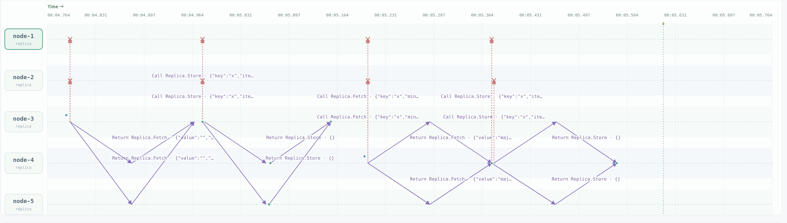

quorum-kv

Observation scenario A

We first use W and R to be both 3, and then conduct a write(including fetch+write), it finishes quickly #62.
Then we set W to be 5, R still 3. The fetch finishes, however the write does not finish until node5 replies, in #132, which is very slow.

supporting logs:

Observation scenarioB:
Writing waits for W acks before it returns success. If the network works well, even if writing returns early, the messages will still get delivered. Here, we killed the network connections from 1, but the write still returns success due to its low requirement.

Most of the times the local copy returns the fastest, our code, however, ensures this behaviour for experimental purpose by:

	invoke(s.id)
	for _, id := range s.members {
		if id != s.id {
			go invoke(id)
		}
	}

Thus when node-3 reads, it reads the stale copy from itself. The messages to other nodes are still sent, but the read operation returns before they receive reply, in #59.
"version":{"counter":0,"writer":""} proves that this is the stale result.

supporting logs:

Observation scenarioC:
Here we use R and W both to be the majority requirement.
node1 and node2 are the minority partition, and the rest form the majority.
node1 tries to write #23, however it only receives reply from node2 and itself. After a 4s timeout, it failed in its fetch stage, shown by #37.

implementation of our timeout:
timer := time.NewTimer(4 * time.Second)
			defer timer.Stop()
			select {
			case done := <-pending.Done:
				err = done.Error
			case <-timer.C:
				answers <- answer{node: id, err: fmt.Errorf("timeout")}
				return

However, in the majority partition writing can still succeed.

reflections:
Why do we need to fetch version first before we write?
Because we need that version to decide our writing version number. And the fetching needs to reach R nodes, while the later write needs to reach W nodes.
If two nodes happen to want to write to the same key at the same time, the one who writes with a later version number wins.

Why do we write back what we read after reading?
A write may be half finished, it may still be in process or have already timed-out, there may be less than W written nodes in that case. We read it on a node, this node then asks more than R nodes, to get the latest version. If we don't write, the next time we read we might read the older data, violating linearizability. However, I argue that writing to itself would be enough, since in our implementation we make sure that of one of the R copies that we read, the local copy is among them.

What kind of consistency does quorum replication guarantee?
It guanrantees per-key linearizability. 